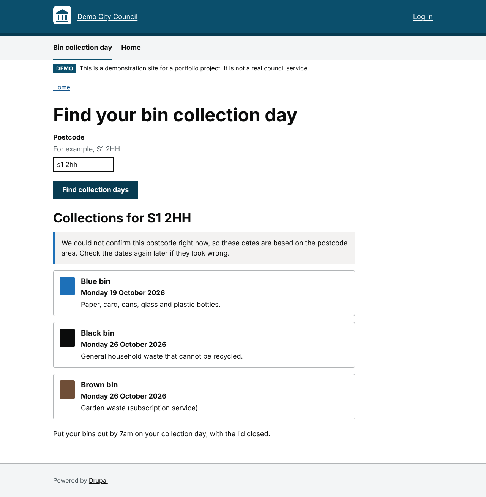
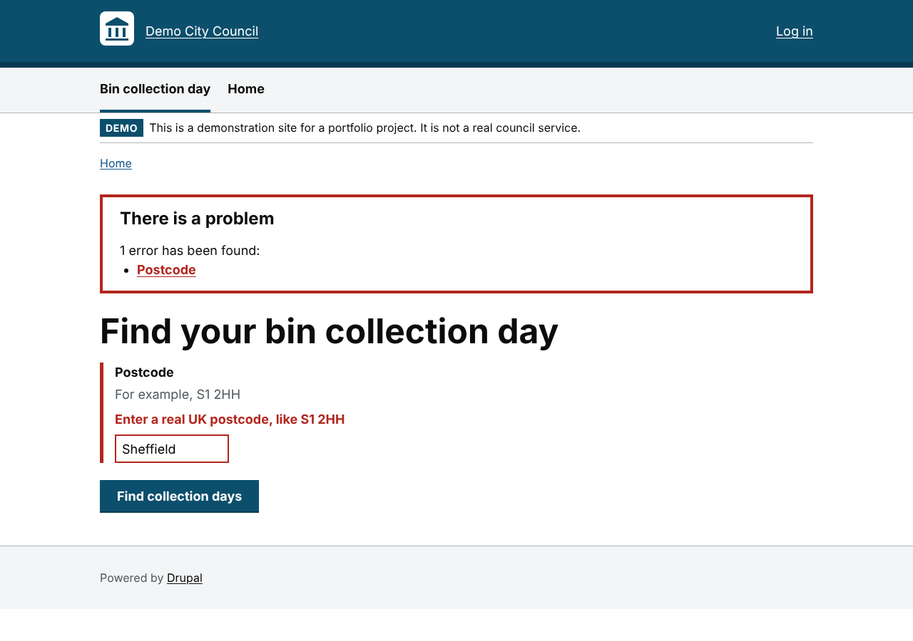
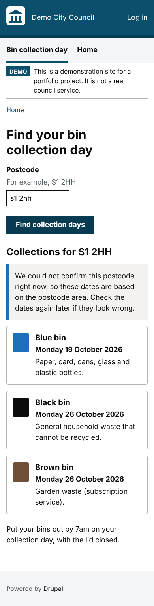
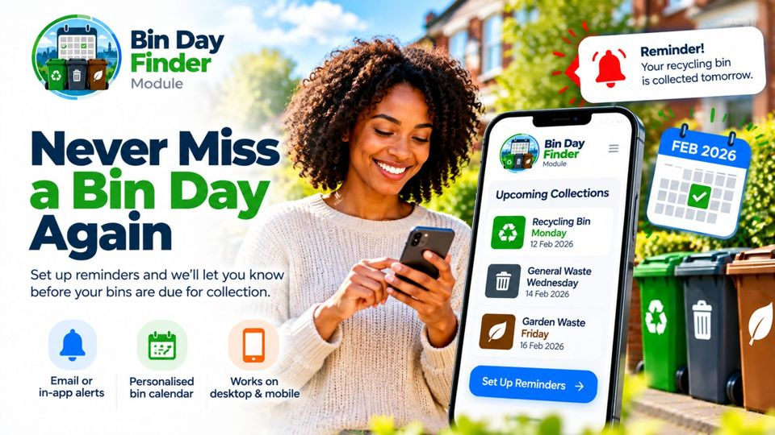
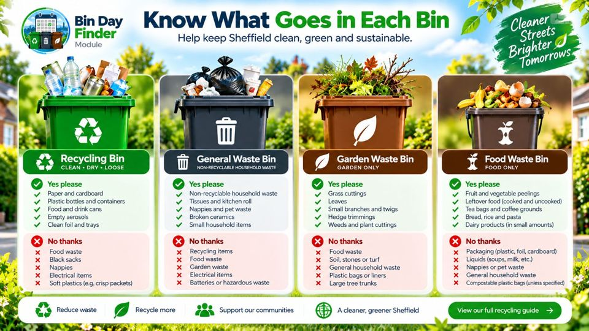
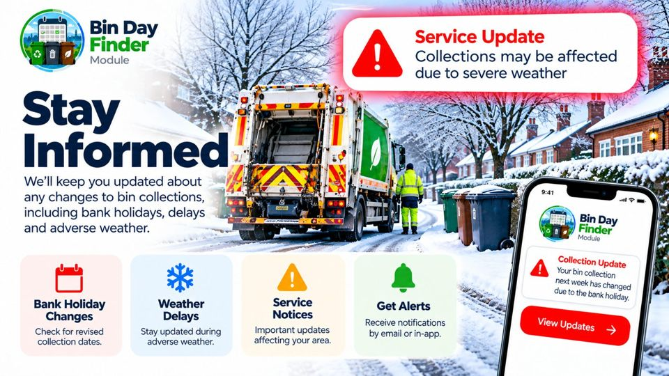

# Council Services on Drupal 11

[](https://github.com/SamAde1203/council-services-drupal/actions/workflows/ci.yml)

A small Drupal 11 site for a fictional local authority, **Demo City Council**. It includes:

- **Bin Day Finder**: a custom module. Residents enter a postcode and see their next black, blue and brown bin collections.
- **Civic**: a custom theme built for accessibility and speed. It meets WCAG 2.2 AA colour contrast, uses no web fonts and needs no JavaScript framework.

> This is a portfolio project. "Demo City Council" is not a real organisation, and the collection dates come from demonstration data.

| Results | Validation error | Mobile |
|---|---|---|
|  |  |  |

## What it demonstrates

| Area | Where to look |
|---|---|
| Custom Drupal module | [`web/modules/custom/bin_day_finder`](web/modules/custom/bin_day_finder): routing, Form API, a config form, a block plugin, services, config with schema, permissions and menu links |
| Modern Drupal 11 patterns | Attribute-based hooks ([`src/Hook`](web/modules/custom/bin_day_finder/src/Hook/BinDayFinderHooks.php)), PHP attributes for plugins, constructor property promotion, `#config_target` on config forms |
| Twig theming | [`web/themes/custom/civic/templates`](web/themes/custom/civic/templates) and the module's [results template](web/modules/custom/bin_day_finder/templates/bin-day-finder-results.html.twig) |
| REST API integration | [`PostcodeLookup`](web/modules/custom/bin_day_finder/src/Service/PostcodeLookup.php) calls [postcodes.io](https://postcodes.io), with timeouts, caching and graceful fallback |
| Accessibility | [`docs/ACCESSIBILITY.md`](docs/ACCESSIBILITY.md): automated axe-core checks run in CI, plus keyboard and focus tests |
| Testing | 26 PHPUnit tests: unit, kernel (mocked HTTP) and functional (real browser requests) |
| Code quality | Drupal and DrupalPractice coding standards (phpcs), enforced in CI |
| Security | Rate limiting with Drupal's flood service, input validation before any API call, restricted admin permission, output escaped by Twig |
| Performance | Cached lookups with cache tags, no web fonts, small CSS, no JavaScript framework |
| Local development | DDEV (Docker) setup and a one-command site install |

## Run it locally

You need [DDEV](https://ddev.readthedocs.io/en/stable/users/install/) and Docker.

```bash
git clone https://github.com/SamAde1203/council-services-drupal.git
cd council-services-drupal
ddev start
ddev composer install
ddev setup-demo      # installs Drupal, the module, the theme and a welcome page
ddev launch
```

`ddev setup-demo` prints a one-time admin login link. Go to **/bin-day** and try a postcode such as `S1 2HH`. The admin settings are at **/admin/config/services/bin-day-finder**.

## Run the checks

```bash
ddev exec vendor/bin/phpcs        # Drupal coding standards
ddev exec vendor/bin/phpunit      # unit, kernel and functional tests

npm install
npx playwright install chromium
BASE_URL=https://council-services.ddev.site npm run a11y   # accessibility checks
```

The same checks run on every push in [GitHub Actions](.github/workflows/ci.yml). The accessibility job installs a fresh site, runs axe-core on desktop and mobile, and uploads screenshots.

## How it works

```
Resident ──> /bin-day (BinDayLookupForm)
               │  validate: flood check ─> PostcodeLookup ─> postcodes.io
               │                               │   (cached 24h; on outage,
               │                               │    falls back to format check)
               │  submit:   CollectionScheduleProvider ─> config: rounds + bins
               └─> rebuilt form + bin-day-finder-results.html.twig
```

- **`Model/Postcode`** normalises input (`" s1 2hh "` becomes `S1 2HH`) and checks the UK format before any network call.
- **`Service/PostcodeLookup`** confirms the postcode exists. A 404 means it isn't real. A timeout or 5xx error is logged, and the resident still gets an answer, labelled as unverified.
- **`Service/CollectionScheduleProvider`** maps the postcode's outward code (`S1`) to a collection round. It works out fortnightly "week A / week B" dates from an anchor date, and handles the clocks changing.
- **`Form/BinDayLookupForm`** works without JavaScript. A small script moves focus to the results heading, so screen reader users know the results have appeared.
- **`Plugin/Block/BinDayFinderBlock`** puts the form in any region. It posts to `/bin-day` so the results always have room to display.

Both services sit behind interfaces and are injected through the service container. That makes them easy to swap, for example for a real waste-management API, and easy to test.

## Design decisions worth discussing

1. **Graceful degradation.** A public service shouldn't fail because a third-party API is down. Lookups fall back to a format check and tell the resident.
2. **Rate limiting.** Each visitor is limited to 20 searches an hour (configurable). This protects the upstream API and the site from scripted abuse.
3. **Protected, non-readonly properties on forms and plugins.** Drupal serialises forms between requests. Its `DependencySerializationTrait` re-injects services from a parent class, which can't write to `private readonly` properties declared in the child. The functional tests caught this.
4. **Stale results are cleared on a new search.** Without this, an error for a new postcode could appear above the *previous* postcode's dates. The functional tests caught this too.
5. **Configuration with schema, not hard-coded data.** Rounds and bins live in `bin_day_finder.schedule` config, so they can be exported, deployed and validated.
6. **The theme ships its own block layout.** Drupal only copies the default theme's blocks into a new theme that has none. Civic ships a full set in `config/optional` so it works straight away.

## Product vision (concept designs, not built)

These AI-generated concept images explore where a service like this could go next. **None of these features exists in the code yet**, and the bin colours shown are illustrative.

| Reminders | What goes in each bin | Service updates |
|---|---|---|
|  |  |  |
| Opt-in emails the evening before, using Drupal's Queue API and cron | Guidance the waste team edits as content, shown beside results | Bank holiday and weather notices that move dates and show a banner |

## Limitations and next steps

- The collection schedule is demonstration data. A real council would connect `CollectionScheduleProviderInterface` to its waste-management system.
- Drupal 11.5 deprecates `.theme` files in favour of hook classes. `civic.theme` should move to `src/Hook` when the site upgrades.
- Possible additions: an AJAX enhancement for the form, Welsh translation, PHPStan at a high level, and manual screen reader testing with NVDA and VoiceOver (see the accessibility report).

## Credits

Postcode data from [postcodes.io](https://postcodes.io) (open data from Ordnance Survey and the ONS, under the Open Government Licence).

Built by [Sam Adeyemi](https://samadeyemi.dev). Licensed under GPL-2.0-or-later, like Drupal.
